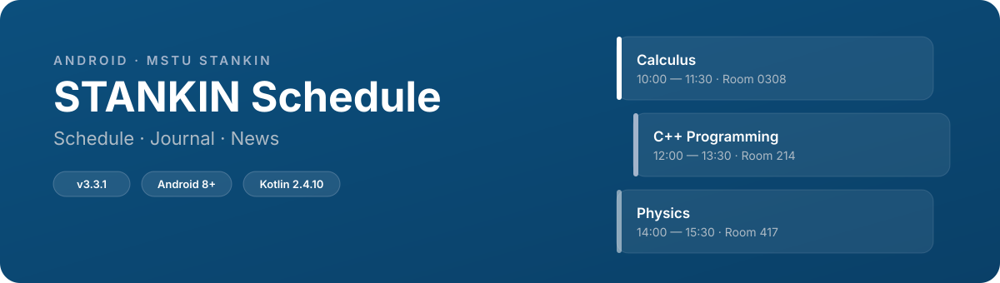

<p align="center">
  
</p>

<p align="center">
  <a href="../../README.md">Русский</a> · <a href="README_en.md">English</a>
</p>

<p align="center">
  <a href="https://play.google.com/store/apps/details?id=com.overklassniy.stankinschedule"></a>
  <a href="https://www.rustore.ru/catalog/app/com.overklassniy.stankinschedule"></a>
  <a href="https://github.com/overklassniy/STANKIN_Schedule_app/releases/latest"></a>
</p>

---

## Screenshots

<div align="center">

| | | |
|:---:|:---:|:---:|
|  |  |  |
|  |  | |

</div>

---

## Features

- **Schedule** — day navigation, import from STANKIN Moodle
- **Module Journal** — grades and ratings
- **News** — university, dean's office, announcements
- **Widgets** — schedule and news on the home screen

---

## Technologies

<p align="center">
  
  
  
  
  
  
  
  
  
  
</p>

---

## Development

<details>
<summary>Requirements and build</summary>

**Requirements:** Android Studio Otter+, JDK 25, Android SDK 37, min API 26

```bash
git clone https://github.com/overklassniy/STANKIN_Schedule_app.git
cd STANKIN_Schedule_app
./gradlew assembleDebug
```

**Sentry DSN** — add your crash reporting key to `local.properties`:
```bash
# local.properties (file is in .gitignore)
sentry.dsn=
```

**RSS news** — create `stankin.secret` from the example:
```bash
cp stankin.secret.example stankin.secret
# Add your RSS feed URLs to stankin.secret (file is in .gitignore)
```

Without these files, the app builds and runs: Sentry will be disabled, news section will be empty.

</details>

---

## Changelog

**v3.4.0** — module journal migrated to the new lko.stankin.ru personal account

Full changelog — [CHANGELOG_en.md](CHANGELOG_en.md)

---

## Authors

- Original project — [Nikololoshka](https://github.com/Nikololoshka) (ProjectPepega)
- Current fork — [overklassniy](https://github.com/overklassniy)

Unofficial application. Provided "as is" without any warranties.

---

<p align="center">
  <strong>Made by students — for STANKIN students</strong>
</p>
