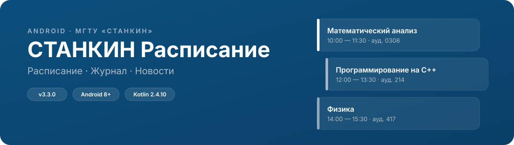
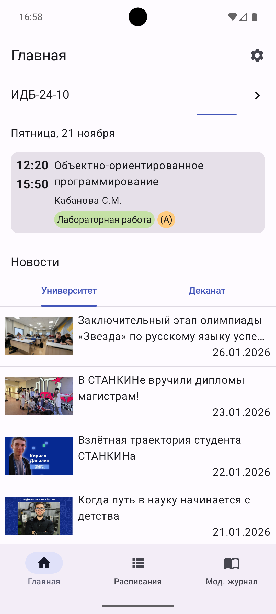
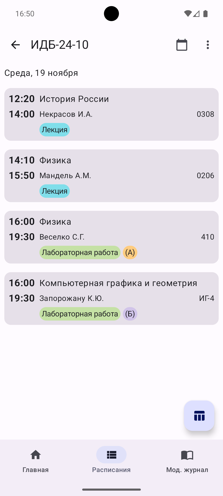
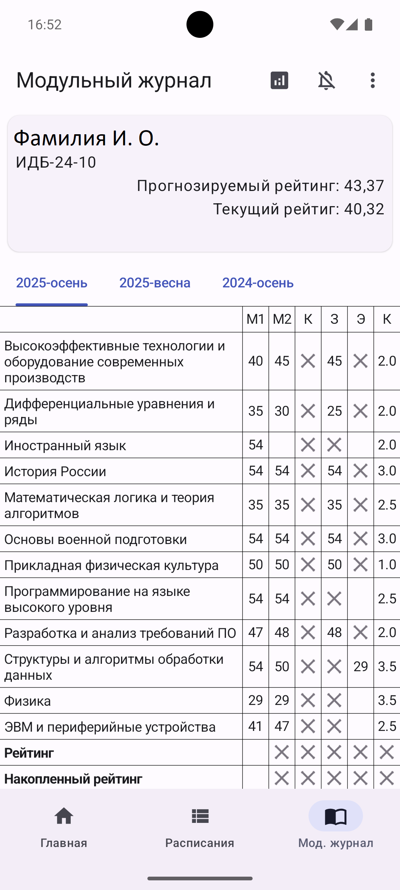
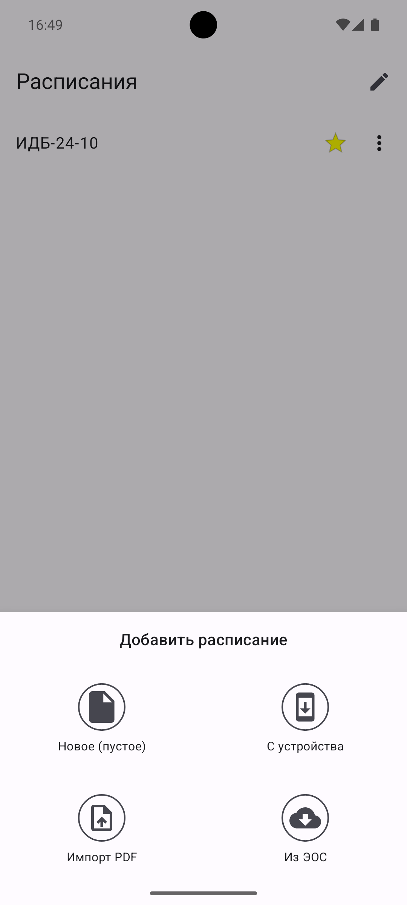
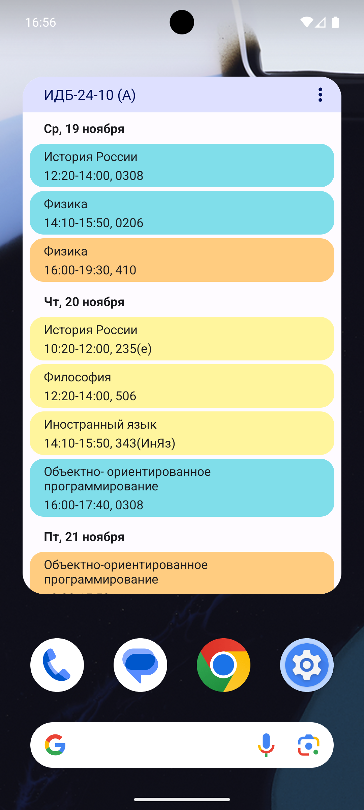

<p align="center">
  
</p>

<p align="center">
  <a href="README.md">Русский</a> · <a href=".info/docs/README_en.md">English</a>
</p>

<p align="center">
  <a href="https://play.google.com/store/apps/details?id=com.overklassniy.stankinschedule"></a>
  <a href="https://www.rustore.ru/catalog/app/com.overklassniy.stankinschedule"></a>
  <a href="https://github.com/overklassniy/STANKIN_Schedule_app/releases/latest"></a>
</p>

---

## Скриншоты

<div align="center">

| | | |
|:---:|:---:|:---:|
|  |  |  |
|  |  | |

</div>

---

## Возможности

- **Расписание** — навигация по дням, импорт из ЭОС МГТУ «СТАНКИН»
- **Модульный журнал** — оценки и рейтинг
- **Новости** — университет, деканат, анонсы
- **Виджеты** — расписание и новости на рабочем столе

---

## Технологии

<p align="center">
  
  
  
  
  
  
  
  
  
  
</p>

---

## Разработка

<details>
<summary>Требования и сборка</summary>

**Требования:** Android Studio Otter+, JDK 25, Android SDK 37, min API 26

```bash
git clone https://github.com/overklassniy/STANKIN_Schedule_app.git
cd STANKIN_Schedule_app
./gradlew assembleDebug
```

**Sentry DSN** — в `local.properties` укажите ключ для краш-репортинга:
```bash
# local.properties (файл в .gitignore)
sentry.dsn=
```

**RSS-новости** — создайте `stankin.secret` из примера:
```bash
cp stankin.secret.example stankin.secret
# Укажите URL RSS-лент в stankin.secret (файл в .gitignore)
```

Без этих файлов приложение собирается и запускается: Sentry будет отключён, раздел новостей — пустым.

</details>

---

## История изменений

**v3.3.0** — миграция на DataStore, переписывание экранов на Compose, обновление зависимостей

Полный список — [CHANGELOG.md](CHANGELOG.md)

---

## Авторы

- Оригинальный проект — [Nikololoshka](https://github.com/Nikololoshka) (ProjectPepega)
- Текущий форк — [overklassniy](https://github.com/overklassniy)

Неофициальное приложение. Предоставляется «как есть» без каких-либо гарантий.

---

<p align="center">
  <strong>Сделано студентами — для студентов СТАНКИН</strong>
</p>
